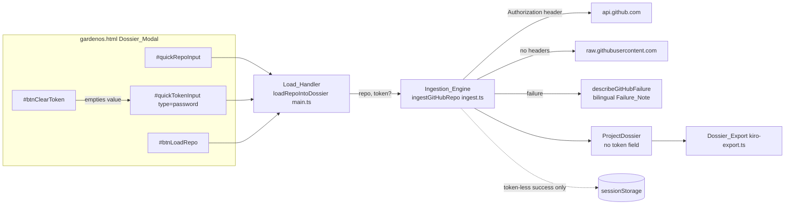

# Design Document: GitHub Repository Token Input

## Overview

This design adds an optional, masked GitHub personal access token field to the Dossier_Modal quick-load row. The field sits beside the existing Repository_Input in gardenos.html. The Load_Handler (`loadRepoIntoDossier` in src/gardenos/main.ts) reads the field and passes the trimmed token as the fourth argument of `ingestGitHubRepo` in src/gardenos/ingest.ts. That function already accepts the token and already sends it as `Authorization: Bearer <token>` on api.github.com calls. The work is the UI, the honest failure messages, the memory-only handling, and the tests.

Verified facts from reading the code:

- `ingestGitHubRepo(repoUrl, visitorName, fetchImpl = fetch, token?)` is defined at src/gardenos/ingest.ts:311. The header is set at line 336. The sessionStorage read is guarded by `if (!token)` at line 321, and the write is guarded by the same condition at line 451.
- Raw file fetches (`fetchRaw`, src/gardenos/ingest.ts:376) call `fetchImpl` with no `headers`. The token therefore reaches only the api.github.com calls made by `request()`.
- The only token-related UI today is none. gardenos.html line 198 has `#quickRepoInput`, and the row is `.dosQuickSwitch` (line 197). The CRT login (src/gardenos/login.ts) has no token field.
- `loadRepoIntoDossier` is at src/gardenos/main.ts:268. It passes no token (line 272). The Enter key path (line 287) and the button path (line 286) both call it with only the repository text.
- The 403 text is `(rate-limited or forbidden)` at src/gardenos/ingest.ts:340. It contains no advice about tokens and no header check.
- Partial warnings for tree and commit failures (src/gardenos/ingest.ts:355 and 359) use the same generic `GitHub HTTP` text.
- `createPresetDossier(presetId, visitorName, fallbackReason?)` at src/gardenos/ingest.ts:575 places `fallbackReason` into both `honestyNote` and `honestyNoteEs` (lines 603 and 604). The Spanish field receives the English reason text.
- The i18n pattern is `tr(en, es, getLang())` from src/gardenos/i18n.ts. The `syncLangUi` function at src/gardenos/main.ts:114 refreshes labels when the language changes.
- Existing tests use the Node test runner, `node --experimental-strip-types --test tests/*.test.ts` (package.json). They call pure functions directly, stub `sessionStorage` through `Object.defineProperty` (tests/story-ingest.test.ts), and read source files with `readFileSync` for structural assertions (tests/dossier-focus.test.ts).
- GitHub's documented limits: 60 requests per hour per IP address for unauthenticated REST requests, and 5,000 per hour for an authenticated user. Rate-limited responses use status 403 or 429. Source: GitHub REST rate-limit documentation, retrieved during this design.

## Architecture



The token flows through one path only: Token_Input value, then the Load_Handler call argument, then the `Authorization` header on api.github.com requests. It never enters the dossier object, Browser_Storage, the Repository_Input, `loginUI`, the URL, or a message.

## Components and Interfaces

### 1. Failure messages (src/gardenos/ingest.ts)

New exports:

```ts
export interface BilingualText { en: string; es: string; }

export class GitHubHttpError extends Error {
  constructor(
    readonly status: number,
    readonly endpoint: string,
    readonly rateLimitRemaining: string | null,
  ) {
    super(`GitHub HTTP ${status} on ${endpoint}.`);
    this.name = 'GitHubHttpError';
  }
}

export function describeGitHubFailure(input: {
  status: number;
  rateLimitRemaining: string | null;
  tokenSupplied: boolean;
}): BilingualText;

export function redactToken(text: string, token: string | undefined): string;
```

`GitHubHttpError` replaces the current string check `error.message.startsWith('GitHub HTTP')` at ingest.ts:458. The error carries only the status, the endpoint path, and the rate-limit header value. It never carries the token or request headers.

`describeGitHubFailure` decides the message from this table. It is a pure function, so tests can call it directly.

| Status | `x-ratelimit-remaining` | Token supplied | English (summary) | Advice to add token |
|---|---|---|---|---|
| 403 or 429 | `0` | No | Request limit reached. Unauthenticated requests are limited to 60 per hour per IP address. A personal access token raises the limit to 5,000 per hour. | Yes |
| 403 or 429 | not `0` or absent | No | Refused (HTTP status). This may be the rate limit or a permission refusal, not confirmed. Unauthenticated requests are limited to 60 per hour per IP address. A personal access token raises the limit to 5,000 per hour. | Yes |
| 403 or 429 | `0` | Yes | The token's limit of 5,000 requests per hour was reached. Wait for the reset, then load again. | No |
| 403 or 429 | not `0` or absent | Yes | GitHub refused this token (HTTP status). It may lack access to this repository, or it may be rate-limited. | No |
| 401 | any | Yes | GitHub rejected the token (HTTP 401). Check the token, or clear it and load without one. | No |
| 404 | any | No | Not found, or private. A private repository requires a token with access. | Yes (private note) |
| 404 | any | Yes | Not found, or the token lacks access to this repository. | No |
| other | any | any | `GitHub HTTP <status>.` with no extra advice. | No |

The Spanish text is produced for each row. Every branch returns a non-empty `en` and a non-empty `es`. The English text for the first row reads as: "Request limit reached. Unauthenticated GitHub API requests are limited to 60 per hour per IP address. A personal access token raises that limit to 5,000 per hour."

`redactToken(text, token)` replaces every occurrence of the trimmed token with `[token hidden]`. It returns the input unchanged when the token is empty or undefined. It is applied to every generated reason string as a safety net. Because the error already excludes the token, redaction should never change a message in practice.

### 2. Ingestion_Engine changes (src/gardenos/ingest.ts)

`ingestGitHubRepo` keeps its public signature. Changes inside the function:

- `request<T>()` (ingest.ts:337-345) reads `res.headers.get('x-ratelimit-remaining')` and throws `new GitHubHttpError(res.status, endpoint-with-repo, remaining)`.
- A local `let rateLimited = false`. Any caught `GitHubHttpError` with status 403 or 429 sets it to true.
- The tree and commit `.catch` handlers (ingest.ts:355 and 359) push both the existing English warning and a Spanish warning into two parallel arrays, `partialWarnings` and `partialWarningsEs`. The Spanish text comes from `describeGitHubFailure(...)`.
- The fatal `catch` at ingest.ts:455-461 builds `reason` from `describeGitHubFailure(...)` for `GitHubHttpError` instances. For other errors it keeps the existing timeout and generic messages, passed through `redactToken`. It calls `createExampleDossier(visitorName, reason.en, reason.es)`.
- `honestyNote` and `honestyNoteEs` append the warnings from the matching array.
- The sessionStorage write becomes `if (!token && !rateLimited)`. The read guard stays `if (!token)`, so a token-supplied load never reads or writes the cache. Requirement 2.8 is satisfied by the new `!rateLimited` condition.

`createExampleDossier` and `createPresetDossier` gain an optional Spanish reason parameter. The signatures become `createPresetDossier(presetId, visitorName, fallbackReason?, fallbackReasonEs?)` and `createExampleDossier(visitorName, fallbackReason?, fallbackReasonEs?)`. When the Spanish argument is missing, the English value is used, which keeps existing callers unchanged. In `createPresetDossier`, `honestyNoteEs` uses `fallbackReasonEs ?? fallbackReason`.

### 3. Dossier_Modal markup (gardenos.html)

Inside `.dosQuickSwitch` (line 197), after the Repository_Input at line 198 and before `#btnLoadRepo`:

```html
<input id="quickTokenInput" type="password" autocomplete="off" autocapitalize="off" spellcheck="false" maxlength="255" data-lpignore="true" aria-describedby="quickTokenHint" placeholder="GitHub token (optional)" aria-label="Optional GitHub personal access token" />
<button class="dosBtnSm" id="btnClearToken" type="button">Clear token</button>
<small id="quickTokenHint" class="dosTokenHint">Optional token. Stays in memory only: never saved to browser storage, the Kiro Revival Pack, or any download. Raises GitHub's limit from 60 to 5,000 requests per hour.</small>
```

Notes on the markup:

- `value` is never set as an HTML attribute. The value exists only as a DOM property, so it is not in page source.
- `autocomplete="off"` stops password-manager save prompts and stops Firefox from restoring the typed value after reload. `data-lpignore` asks common password managers to skip the field.
- No `<form>` wraps the row, so no implicit form submission or form-state storage applies.
- The `.dosQuickSwitch input` rule (gardenos.html line 117) already styles the new input. The hint needs a new rule `.dosTokenHint{flex:1 1 100%;font:11px/1.4 "Courier New",monospace;color:#9fb3b4}` so it wraps to its own line in the flex-wrap row. The hint is a `<small>` element with no interactive controls.
- Tab order is Repository_Input, Token_Input, Clear token, Load GitHub, then the existing buttons. That order follows the DOM and keeps the Tab and Shift+Tab handler in main.ts:915-923 unchanged, since that handler collects `button,input,textarea` in DOM order.

### 4. Load_Handler and wiring (src/gardenos/main.ts)

```ts
const quickTokenInput = byId('quickTokenInput') as HTMLInputElement;

const loadRepoIntoDossier = async (repoStr: string, token = '') => {
  const q = repoStr.trim();
  if (!q) return;
  const t = token.trim();
  byId('dosHonest').textContent = tr(
    t ? `Fetching ${q} with a token held in memory only…` : `Fetching ${q}…`,
    t ? `Consultando ${q} con un token solo en memoria…` : `Consultando ${q}…`,
    getLang(),
  );
  const d = await ingestGitHubRepo(q, loginUI.name || 'Visitor', undefined, t || undefined);
  loginUI.setOrigin('GitHub'); loginUI.setRepo(q);
  await openDossier(true, d);
};
```

Changes to the wiring:

- Line 286 (`btnLoadRepo.onclick`) passes `quickTokenInput.value` as the second argument.
- Line 287 (Enter on `#quickRepoInput`) passes the same value.
- New Enter listener on `quickTokenInput` calls `loadRepoIntoDossier(repoInput.value, quickTokenInput.value)` after `preventDefault`.
- New `btnClearToken.onclick = () => { quickTokenInput.value = ''; }`. The focus stays on the Clear control.
- `syncLangUi` (main.ts:114) sets the placeholder, aria-label, hint text, and clear button text with `tr(...)`.
- `loadRepoIntoDossier` calls from the URL (line ~355), boot (line ~303), and the 3D path are unchanged. They pass no token, so their behavior does not change.
- No `console.*` call is added. No storage call is added.

The `loginUI.setRepo(q)` call stores only the trimmed repository text (Requirement 2.4). The token is never passed to `loginUI`.

### 5. Decision: CRT login screen

Decision: the CRT login screen does not gain a token field in this feature. The Quick Dossier is the only token entry point.

| | Option A: Dossier_Modal only (chosen) | Option B: also in CRT login |
|---|---|---|
| Cost | Markup, wiring, and tests in two existing files. | login.ts draws on a canvas. The only text entry is the hidden `nameInput` shared between name and repo modes (main.ts:521-527 and 887). A masked field needs a new focus state, a masked canvas render, and a second hidden input. The token would also need to reach `buildDossier` (main.ts:548-557), which runs during the 3D transition. |
| Benefit | Every GitHub load in the dialog can take a token. The token-loaded dossier is reused when the visitor enters 3D, because `buildDossier` returns `activeDossier` when the GitHub id matches (main.ts:549). | Covers visitors who start from the CRT screen. The Quick Dossier button is visible from the start (gardenos.html line 30-31, the `#quickBar` always-available control), so those visitors can still reach the token field in one click. |
| Risk | A visitor who enters 3D straight from the CRT screen loads without a token (main.ts:554). | Larger change to a canvas UI and to the login state machine, which existing tests cover (tests/story-ingest.test.ts checks login reset). |

Hypothesis (unconfirmed): visitors who hit the limit from the CRT path will mostly open the Quick Dossier to retry, because the honest message names it. This has not been measured. Revisit Option B only if the CRT GitHub path produces rate-limit failures in practice.

Load estimate, computed from code reading and not measured: a repository load makes 4 api.github.com calls (metadata, tree, commits, and README). Raw file fetches and manifest fallbacks do not count against the REST API quota. At 60 calls per hour, an unauthenticated visitor can load about 15 repositories per hour before the limit applies, and the limit is per IP address, so it is shared with other visitors on the same network.

### 6. Security boundaries

| Path | Token behavior | Enforced by |
|---|---|---|
| Browser_Storage writes | None when a token is supplied. | `if (!token && !rateLimited)` at the sessionStorage write (ingest.ts:451). Tests stub `sessionStorage` and count calls. |
| Browser_Storage reads | None when a token is supplied. | `if (!token)` at ingest.ts:321. |
| Outgoing requests | `Authorization` only on `https://api.github.com/` URLs. Raw file URLs have no headers. | `request()` header set; `fetchRaw` passes no headers. Tests record every fetch call. |
| Dossier and exports | Not present. The dossier is built from response data only. | `assemble` receives no token field. Tests search dossier JSON and export strings for the fixture token. |
| Repository field, `loginUI`, URL | Not present. | Load_Handler stores `q` only. No URL parameter reads a token. |
| Error and Honesty_Note text | Not present. | `GitHubHttpError` excludes the token. `redactToken` is applied to every generated reason. |
| Logs | None added. | No `console` call. |
| Page scripts | Only the app module is loaded (`<script type="module" src="/src/gardenos/main.ts">`). The token is readable by that module's code, which the repository owns. | Review of gardenos.html. |

Input value lifetime: the token stays in the DOM property until the visitor clicks Clear, closes the page, or reloads. It is not cleared on dialog close, so a visitor can retry without retyping it.

### 7. Honest UI text (English and Spanish)

| Key | English | Spanish |
|---|---|---|
| Placeholder | GitHub token (optional) | Token de GitHub (opcional) |
| Accessible label | Optional GitHub personal access token | Token personal de GitHub opcional |
| Hint | Optional token. Stays in memory only: never saved to browser storage, the Kiro Revival Pack, or any download. Raises GitHub's limit from 60 to 5,000 requests per hour. | Token opcional. Se guarda solo en memoria: nunca en el almacenamiento del navegador, en el Kiro Revival Pack ni en ninguna descarga. Eleva el límite de GitHub de 60 a 5.000 peticiones por hora. |
| Clear button | Clear token | Borrar token |
| Loading status with token | Fetching {repo} with a token held in memory only… | Consultando {repo} con un token solo en memoria… |

The Failure_Note texts are defined in `describeGitHubFailure` (section 1).

## Data Models

No persisted model changes. `ProjectDossier` keeps its fields. Its `honestyNote` and `honestyNoteEs` strings may contain Failure_Note text, which never includes a token. No new field is added to `ProjectDossier`, so the export functions in kiro-export.ts need no change.

## Error Handling

| Condition | Result shown to the visitor | Storage effect |
|---|---|---|
| Meta request 403/429, no token | Fallback Sentinel dossier, DEMO badge, honest note with the 60/hour advice. | No sessionStorage write (rate-limited). |
| Meta request 403/429, token | Fallback dossier with the token-limit or refusal text, no advice to add a token. | No cache read or write (token-supplied). |
| Meta request 401, token | Fallback dossier stating that GitHub rejected the token. | No cache write. |
| Tree or commit request fails with 403/429 | Dossier with partial-warning Failure_Note in both languages. | No sessionStorage write (rate-limited, no token). |
| Network error or timeout | Existing timeout text (9 s) or generic error, passed through `redactToken`. | Unchanged. |
| Token contains surrounding whitespace | Trimmed before use. | None. |
| Token longer than 255 characters | Blocked by `maxlength`, so the input cannot exceed 255 characters. | None. |

## Correctness Properties

The repository has no property-based testing library. The tests in this feature are example-based and table-driven. Each property below is checked with a small fixture set, and the fixtures cover several token values and status codes.

### Property 1: Token confidentiality

For each fixture token, the dossier object, the JSON text of the dossier, `formatKiroRevivalSpec`, `formatKiroRequirementsMd`, `formatKiroDesignMd`, `formatKiroTasksMd`, `formatKiroHookJson`, and `formatArchiveCard` output contain no occurrence of the token. **Validates: Requirements 2.6, 2.7**

#### Property 2: Authorization scope

For a load with a non-blank token, every recorded fetch URL that carries the `Authorization` header starts with `https://api.github.com/`, and every raw URL has no `headers` option. For a load with a blank or absent token, no recorded request carries `Authorization`. **Validates: Requirements 2.2, 1.6**

#### Property 3: Storage invariance under token

For a load with a token, the stubbed sessionStorage records zero `getItem` calls and zero `setItem` calls. **Validates: Requirement 2.3**

#### Property 4: Advice appears only without a token (metamorphic)

For every status in {403, 429} and every `x-ratelimit-remaining` value in {`0`, `5`, null}, the English text from `describeGitHubFailure` with `tokenSupplied: true` does not contain "raises" or "Add". The same input with `tokenSupplied: false` does contain "5,000". For status 404, the text with no token contains "requires a token", and the text with a token does not. **Validates: Requirements 3.1, 3.4, 3.6**

#### Property 5: Bilingual completeness

For every input in the Property 4 grid, plus status 401 with a token and status 500 without one, both `en` and `es` are non-empty strings and `es` is not equal to `en`. **Validates: Requirement 4.3**

#### Property 6: Redaction idempotence

For a token `t` and text `x`, `redactToken(redactToken(x, t), t) === redactToken(x, t)`. When `x` contains `t`, the output does not contain `t`. **Validates: Requirement 2.7**

#### Property 7: Limit confirmation

`describeGitHubFailure` with a 403 and a remaining value that is not `0` never contains the word "reached". It contains "possibly" or "may". **Validates: Requirement 3.3**

#### Property 8: Cache skip after rate limit

For a token-less load whose meta or tree request returns 403, the sessionStorage `setItem` count is zero. **Validates: Requirement 2.8**

## Testing Strategy

Test file: `tests/github-token-input.test.ts`. It runs under `npm test`, which globs `tests/*.test.ts` (package.json).

- Pure function tests call `describeGitHubFailure` and `redactToken` directly, covering Properties 4 through 7.
- Ingestion tests call `ingestGitHubRepo` with a stubbed `fetchImpl` that records each `(url, init)` pair and returns `Response` objects. A stubbed `sessionStorage` records calls, as in tests/story-ingest.test.ts. These tests cover Properties 1, 2, 3, and 8, and check that the honesty note contains the required Failure_Note text.
- Source-text tests read gardenos.html and src/gardenos/main.ts with `readFileSync` and assert these facts, in the style of tests/dossier-focus.test.ts:
  - `#quickTokenInput` is `type="password"`, has `autocomplete="off"`, has no `value` attribute, and appears inside `#dossierModal` after `#quickRepoInput` and before `#btnLoadRepo`.
  - `loadRepoIntoDossier` passes the token as the fourth argument to `ingestGitHubRepo`.
  - `loadRepoIntoDossier` body contains no `localStorage`, no `sessionStorage`, and no `console.` call.
  - The URL query path does not read a `token` parameter (`qs.get('token')` does not appear).
  - `syncLangUi` contains the new placeholder and hint text keys.
  - The `buildDossier` branch in main.ts (lines 549-550) that returns `activeDossier` for a matching GitHub id is unchanged (Requirement 6.2).
- Keyboard and focus behavior (Requirement 5) and the visual hint placement cannot run without a DOM. They are covered by the manual checklist in tasks.md, not by automated tests.

## Out of Scope

- A token field on the CRT login screen (see section 5).
- Storing, remembering, or validating token format. The field accepts any text up to 255 characters, and GitHub decides whether the token is valid.
- Changes to the 3D entry path beyond what it already does.
- Other encoding or copy issues in unrelated strings.
