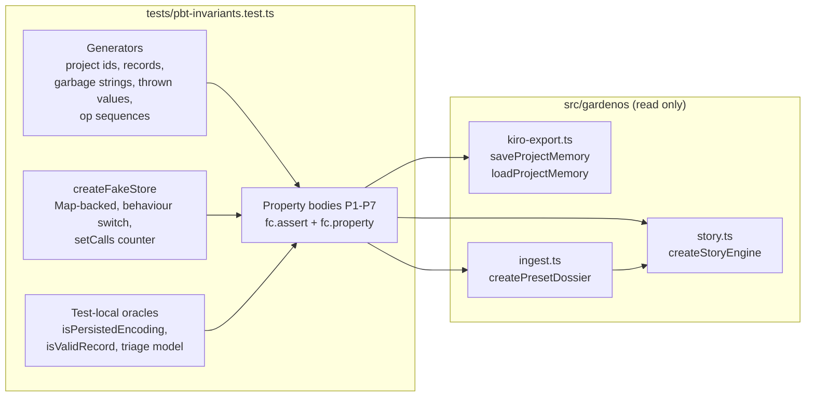

# Design Document: pbt-persistence-invariants

## Overview

This design covers `tests/pbt-invariants.test.ts`, a fast-check suite that checks five invariants in the GardenOS code:

1. Memory round trip through `saveProjectMemory` and `loadProjectMemory` (`src/gardenos/kiro-export.ts`).
2. Honest save failure when the store throws.
3. Corruption tolerance on load when the stored string is garbage.
4. Load survives a throwing `getItem`.
5. Invalid Project_Memory_Records are rejected before any write.
6. Triage selection integrity in the story engine (`src/gardenos/story.ts`): no duplicate ids, membership consistent with `isTodoSelected`, and every selected id inside the dossier's track ids.
7. A fresh engine selects every track.

The suite changes only the test side. Per the requirements, no file under `src/` changes in this phase, and nothing is committed to git. The design includes a fix plan for the one property the code is expected to fail (Property 2, described under Error Handling). That fix is a task for the tasks phase, applied in the same session.

Source facts the design depends on, all read from the working tree:

- `kiro-export.ts` line 229: `memoryKey = (id) => 'sd_memory_v1:' + id`. The key is injective in `id` because the prefix is fixed.
- `kiro-export.ts` lines 230-234: `isMemory` checks that `creatorNote` is a string, `verdict` is `null` or one of the three enum strings, and `savedAt` is absent or a string. It ignores extra keys.
- `kiro-export.ts` lines 235-242: `loadProjectMemory(projectId, storage?)` wraps the whole read in `try/catch` and returns `null` on any failure.
- `kiro-export.ts` lines 243-251: `saveProjectMemory(projectId, data, storage?)` returns early with `{ ok: false, error: 'Invalid project memory record.' }` at line 245, before calling `setItem`. Its `catch` (lines 248-250) builds `` `${error.name}: ${error.message}` `` on line 249 for `Error` instances and `'Storage unavailable.'` otherwise.
- `story.ts` line 119: `createStoryEngine(dossier, pace = 'full', memory?)`. The engine keeps a reference to the dossier object and mutates `dossier.selectedTodoIds` directly.
- `story.ts` `toggleActiveTodoForKiro`: builds a `Set` from `dossier.selectedTodoIds ?? todos ids`, flips the current track's id, and writes back `[...set]`. Its selected ids therefore come only from the todo id list.
- `story.ts` `isTodoSelected(id)`: returns `picked.includes(id)`, where `picked` is `selectedTodoIds ?? all todo ids`.
- `story.ts` `interactIslandPoi('tv')`: the first call sets `tapePlayed` and `isNight`. Later calls advance `activeTodoIndex` modulo the todo count when there is more than one track. Neither path touches the selection.
- `ingest.ts` `createPresetDossier` (line 675) structure-clones the preset, sets `selectedTodoIds` to all todo ids, and sets `activeTodoIndex` to 0. For `sentinel-lab` the ids are `sentinel-tape-timeout` and `sentinel-tape-cidr` (`presets.ts` lines 697 and 705).
- `i18n.ts`: `getLang()` returns a module variable. `detectLang` reads `globalThis.localStorage` only inside `try`, so the story module loads under plain Node. The existing `tests/story-ingest.test.ts` already imports these modules this way.

## Architecture

The suite has three layers: fakes and generators (test-only), property bodies, and the code under test. Nothing else in the repo changes.



The fake store and the oracles sit on the test side on purpose. The oracles restate the requirements from the glossary. They do not import `isMemory` or any other function from the code under test. A test that reuses the implementation's predicate can pass even when the predicate is wrong.

## Components and Interfaces

### Test harness and runner

- File: `tests/pbt-invariants.test.ts`. The existing glob `tests/*.test.ts` picks it up, so `npm test` (`node --experimental-strip-types --test tests/*.test.ts`) runs it without a script change.
- Imports use `node:test` (`test`) and `node:assert/strict`, matching the other suites in `tests/`.
- Imports of fast-check use the namespace form: `import * as fc from 'fast-check';`. The namespace form works whether the package resolves as ESM or CJS. This is a choice made to avoid depending on a default export; it is verified on install (see Testing Strategy).
- Every source import uses an explicit `.ts` extension, as the existing tests do, because the runner does not rewrite specifiers.
- Type-only imports use `import type`. The runner strips types without a checker, so the file must avoid `enum`, `namespace`, and parameter properties.
- Each property is one `test(...)` that calls one `fc.assert(fc.property(...), { numRuns })`. The `test` name carries the property number and title.

### Fake store (`createFakeStore`)

The fake is a `Map`-backed object with the two methods `saveProjectMemory` and `loadProjectMemory` use: `getItem(key)` and `setItem(key, value)`. It takes a behaviour value so one factory covers each storage mode:

```ts
type StoreBehaviour =
  | { kind: 'ok' }
  | { kind: 'setThrows'; value: unknown }
  | { kind: 'getThrows'; value: unknown }
  | { kind: 'getReturns'; value: unknown };

interface FakeStore {
  getItem(key: string): string | null;
  setItem(key: string, value: string): void;
  readonly map: Map<string, string>;
  setCalls: number;
}
```

Rules for the fake:

- `setCalls` increments on every `setItem` call, including ones that then throw. Property 5 needs this count.
- `setThrows` and `getThrows` throw `value` exactly as given. The value can be `undefined`, `null`, a Symbol, or an Error variant, so the throw must not wrap it.
- `getReturns` returns `value` unchanged. It exists so the property can feed non-string values, which the real `Storage` never does but the loader must tolerate.
- The fake never reads `localStorage` or any other global, which keeps Requirement 2.3 true.

### Generators

All generators are local to the test file. The verdict set is written out in the test (`'archive' | 'restore' | 'leave'`), not imported.

| Generator | Built from | Purpose |
| --- | --- | --- |
| `projectIdArb` | `fc.oneof(fc.string(), fc.string({ unit: 'grapheme' }), fc.constantFrom('', ':', 'a:b', 'sentinel-lab'))` | Arbitrary project ids, including empty, colons, and non-ASCII. |
| `noteArb` | Weighted `fc.oneof`: `fc.constant('')`, multi-line constants such as `'line1\nline2'` and `'a\r\nb\n\nc'`, non-ASCII constants such as `'café'`, `'Ñandú 🌿 日本語'`, and `'\u2028'`, plus `fc.string({ unit: 'grapheme' })` | `creatorNote` values, covering Requirement 3.4. |
| `isoArb` | `fc.date` mapped to `toISOString()` | `savedAt` strings. |
| `recordArb` | `fc.tuple(noteArb, verdictArb, fc.option(isoArb, { nil: null }))` mapped to an object | Valid records. The `savedAt` key is **omitted** when the option is `null`, never set to `undefined`. |
| `invalidRecordArb` | `fc.oneof` of three categories, each tagged: `missing-note`, `bad-verdict` (`fc.constantFrom('ARCHIVE', 'none', '', ' archive')`, `fc.string()` filtered to non-enum, `fc.integer()`, and an explicit `undefined` verdict), and `bad-note-type` (`fc.integer()`, `fc.boolean()`, `fc.constant(null)`, `fc.constant(undefined)`, `fc.array(fc.string())`) | Invalid records for Property 5. Tags let the failure message say which rule was broken. |
| `garbageStringArb` | `fc.oneof` of `fc.string()`, `fc.string({ unit: 'grapheme' })`, `fc.json()`, a `fc.constantFrom` list (`''`, `'null'`, `'0'`, `'[]'`, `'"x"'`, `'{'`, `'NaN'`, `'{"creatorNote":1,"verdict":null}'`, `'{"creatorNote":"","verdict":"maybe"}'`, `'{"creatorNote":"","verdict":null,"savedAt":5}'`), and a truncation of a valid encoding at a generated index | Strings for Properties 3. Truncated valid encodings make near misses likely. |
| `thrownArb` | `fc.constantFrom(...factories).map((make) => make())`, where the factories are: `null`, `undefined`, `'quota'`, `42`, `Symbol('s')`, `new Error('quota exceeded')`, `new Error('')`, an Error whose `name` is a Symbol, an Error whose `message` is a Symbol, an Error with a throwing `name` getter, and a `Proxy` over an Error whose `get` trap throws | Thrown values for Properties 2 and 4. Factories build fresh objects per run, so no state leaks between runs. |
| `triageOpsArb` | `fc.array(fc.constantFrom('toggle', 'tv'), { maxLength: 40 })` | Triage_Operation sequences for Property 6. |
| `syntheticTodosArb` | `fc.uniqueArray(fc.stringMatching(/^[a-z][a-z0-9-]{0,15}$/), { minLength: 0, maxLength: 8 })` mapped to `TodoTrack`-shaped objects with fixed `path`, `lineNumber`, `excerpt`, `tag`, and `score` | Synthetic id lists for Property 6b. See the decision on fabricated data under Testing Strategy. |
| `savedMemoryArb` | `recordArb` mapped to a `SavedProjectMemory` | Restored memory for Property 7. |

### Oracles (test-local)

- `expectedLoad(raw: string): SavedProjectMemory | null`. Returns `JSON.parse(raw)` when it parses to a non-null, non-array object with `creatorNote` a string, `verdict` in the enum or `null`, and `savedAt` absent or a string. Extra keys are allowed (Decision D1). Otherwise returns `null`. Written from the glossary, not from `isMemory`.
- `isValidRecord(value: unknown): boolean`. The same shape rule as `expectedLoad`, applied to a record instead of a string. Property 5 checks the generator's tags against it.
- `modelTriage`. A plain object `{ selected: Set<string>, index: number }`, with `n` the number of tracks and `ids` the track id list in order:
  - `tv` after tape: `index = (index + 1) % n` when `n > 1`, otherwise unchanged.
  - `toggle`: when `n > 0`, flip membership of `ids[index]`; when `n === 0`, no change.

### Dossier and engine fixtures

- A fresh `createPresetDossier('sentinel-lab', 'Visitor')` per property run. `toggleActiveTodoForKiro` mutates `selectedTodoIds`, so sharing one dossier across runs would leak state and break shrinking.
- A fresh `createStoryEngine(dossier, 'demo', null)` per run, unless the property sets pace or memory.
- `playTape(engine)`: calls `interactIslandPoi('tv')` once and asserts `engine.tapePlayed === true`. This setup step is not a Triage_Operation, matching the glossary definition, which counts only `tv` calls made after the tape has played.
- Synthetic variant (6b): `structuredClone` a fresh Sentinel dossier, then replace `todos` with the generated tracks, `selectedTodoIds` with their ids, and `activeTodoIndex` with 0. The clone keeps `tapeClue` and the other fields the engine reads. The engine needs them even when the todo list is empty.

## Data Models

The suite uses these shapes. They come from the code and are not new product types.

```ts
// From kiro-export.ts (SavedProjectMemory), mirrored in test code only as a type
interface SavedProjectMemory { creatorNote: string; verdict: 'archive' | 'restore' | 'leave' | null; savedAt?: string }

// Store contract, a subset of Storage
type MemoryStore = { getItem(key: string): string | null; setItem(key: string, value: string): void };

// Result of saveProjectMemory
type SaveResult = { ok: boolean; error?: string };

// Triage model state, test-local
interface TriageModel { selected: Set<string>; index: number }
```

Key and data rules:

- Stored value: `JSON.stringify(record)` under `sd_memory_v1:<projectId>`. Because `undefined` keys vanish in JSON, generated records must not carry `savedAt: undefined`. Property 1 checks this explicitly.
- Key collision: none is possible across distinct ids, since the prefix is fixed and the suffix is the raw id.

## Correctness Properties

*A property is a characteristic or behavior that should hold true across all valid executions of a system-essentially, a formal statement about what the system should do. Properties serve as the bridge between human-readable specifications and machine-verifiable correctness guarantees.*

PBT applies here. The persistence functions are pure over an injected store, and the triage engine is a deterministic state machine. Both have universal invariants: round trips, honest results, and set membership. The seven properties below each become one fast-check property test.

### Property 1: Memory round trip

For any project id string and any valid Project_Memory_Record, saving the record and then loading it with the same id against the same store returns a record deep-equal to the saved one. The `savedAt` key is present in the result exactly when it was present in the input, and when present it carries the same string.

**Validates: Requirements 3.1, 3.2, 3.3**

### Property 2: Honest save result

For any valid Project_Memory_Record and any store behaviour, where the store either accepts `setItem` or throws any value `v` from it, `saveProjectMemory` never throws. Its result has `ok === false` when the store threw and `ok === true` when it did not. When `ok` is false, `error` is a non-empty string. When `ok` is true, the result deep-equals `{ ok: true }`, with no `error` key.

**Validates: Requirements 4.1, 4.2, 4.3**

### Property 3: Garbage string load

For any string `s` stored under the Memory_Key, `loadProjectMemory` completes without throwing and returns `expectedLoad(s)`. That is the parsed record when `s` is a Persisted_Encoding, and `null` otherwise.

**Validates: Requirements 5.1, 5.2**

### Property 4: Load survives a throwing store

For any value `v` thrown by `getItem`, `loadProjectMemory` returns `null` and does not throw.

**Validates: Requirements 5.3**

### Property 5: Invalid records are rejected before any write

For any invalid record (missing `creatorNote`, `verdict` outside the enum, or non-string `creatorNote`) and any previously stored valid record under the same id, `saveProjectMemory` returns `ok === false`. For the missing-note and bad-verdict categories, `error` is a non-empty string. `setItem` is called zero times. The stored value is unchanged afterward.

**Validates: Requirements 6.1, 6.2, 6.3, 6.4**

### Property 6: Triage selection matches the model

For any sequence of Triage_Operations applied to a dossier whose track id list is `T`, after every operation: the selected array has no repeated id; every selected id is in `T`; `isTodoSelected(id)` equals model membership for every `id` in `T`; the selected set equals the model set; and `engine.activeTodoIndex` equals the model index.

This property runs in two variants with the same body:

- **6a (Sentinel)**: the Sentinel_Dossier with `T = {sentinel-tape-timeout, sentinel-tape-cidr}`.
- **6b (synthetic ids)**: generated unique track id lists with `|T|` from 0 to 8, built from a structure-cloned Sentinel dossier.

**Validates: Requirements 7.1, 7.2, 8.1**

### Property 7: Fresh engine selects every track

For any pace in `{demo, full}` and any optional saved memory, a Triage_Engine created from the Sentinel_Dossier starts with a selected set equal, as a set, to the todo id set `T`, and `isTodoSelected(id)` is `true` for every `id` in `T`.

**Validates: Requirements 8.2**

## Reflection on the Property Set

This is the Property Reflection step. It lists each property, the requirement clauses it validates, and the redundancy decisions.

Each property below is listed with the requirement clauses it validates and the reason for its boundary. Clauses that merge into another property are noted so no requirement is missing.

| Property | Title | Validates | Reflection |
| --- | --- | --- | --- |
| 1 | Memory round trip | 3.1, 3.2, 3.3 | 3.2 and 3.3 are specializations of 3.1. Round-trip deep equality already implies both, but the requirement names them, so they are explicit field assertions inside Property 1 instead of separate tests. |
| 2 | Honest save result | 4.1, 4.2, 4.3 | 4.1, 4.2, and 4.3 are the two branches of one biconditional (ok iff the store accepted the write). One property with both branches keeps the failing counterexample in one place. |
| 3 | Garbage string load | 5.1, 5.2 | 5.2 (no throw) is the same string path as 5.1. Folding it in means any escape from the loader fails the same run that checks the return value. |
| 4 | Load survives a throwing store | 5.3 | Kept separate from Property 3. It uses a different storage behaviour and a different code path (the `catch` in `getItem`). Merging would hide which path failed. |
| 5 | Invalid records are rejected before any write | 6.1, 6.2, 6.3, 6.4 | One invalid-record generator covers all four clauses. The setItem count and the pre-seeded value (6.4) are assertions in the same run. |
| 6 | Triage selection matches the model | 7.1, 7.2, 8.1 | 7.1, 7.2, and 8.1 all use the same operation sequences. A model-equality check implies the no-duplicates check on the selected array and also catches foreign ids (the model only holds track ids). A separate subset-only property would add no coverage, so 8.1 folds in. |
| 7 | Fresh engine selects every track | 8.2 | Kept separate. It is about construction, not sequences. Pace and memory are the only inputs that could plausibly change the initial state, so both are generated. |

Clauses handled outside the property set:

- **3.4** (generator must include empty, multi-line, and non-ASCII notes) is a property of the generator, not the code. It is checked by a fixed-seed coverage example (`fc.sample` with a fixed seed, asserting the sample contains `''`, a string with `\n`, and a string with a code point above `0x7f`).
- **2.1** (numRuns between 100 and 200) is a configuration check on the test file. Each `numRuns` value is a literal in the file, and the coverage example asserts they are in range.
- **2.2** (5000 ms budget) is a measurement. The tasks phase records one timed `npm test` run in the final result.
- **2.3** (no DOM globals) is a smoke check. The suite asserts `globalThis.window` and `globalThis.document` are undefined.
- **1.1, 1.2, 1.3** are manifest and script checks. They are verified by reading `package.json` and running `npm test` once.
- **9.1 to 9.4** are process requirements on the spec and the final report, not code behaviour. They are recorded in the final result, not in the suite.

Expected first-run results. These are predictions from reading the code and from the probes listed under Error Handling. They are not observed results. The first real run decides, and the final result must record what happened.

| Property | Expected first run | Basis |
| --- | --- | --- |
| 1 | Pass | Round trip through JSON with no undefined keys in generated records. |
| 2 | **Fail** (expected finding) | Probe showed `saveProjectMemory` throws for Symbol-named or Symbol-messaged Errors and for throwing `name` getters. |
| 3 | Pass | Probe showed extra keys load and non-string `getItem` returns null. |
| 4 | Pass | `loadProjectMemory` catches all errors. Probe showed Symbol throws and numeric returns handled. |
| 5 | Pass | Validation returns before `setItem`. |
| 6a, 6b | Pass | Selection changes only through `Set` construction over track ids. The probe confirmed toggle and tv behaviour on the Sentinel dossier. |
| 7 | Pass | Fresh engine reads `selectedTodoIds`, which the preset sets to all ids. |

## Error Handling

### Expected finding: Property 2 (honest save failure)

Requirement 4.1 says a failed `setItem` must produce `ok: false` for any thrown value. The code does not meet that for some values.

Evidence, from running the real `saveProjectMemory` with a store whose `setItem` throws (read-only probe script in a temp folder outside the workspace, deleted afterward):

| Thrown value | Result |
| --- | --- |
| `new Error('quota')` | `{"ok":false,"error":"Error: quota"}` |
| `null` | `{"ok":false,"error":"Storage unavailable."}` |
| `new Error('')` | `{"ok":false,"error":"Error: "}` |
| Error with `name = Symbol('n')` | **Throws** `TypeError: Cannot convert a Symbol value to a string` |
| Error with `message = Symbol('m')` | **Throws** `TypeError: Cannot convert a Symbol value to a string` |
| Proxy over Error whose `get` trap throws on `name` | **Throws** `RangeError: trap` |

Cause: `kiro-export.ts` line 249 builds the error text with a template literal, `` `${error.name}: ${error.message}` ``. Template literals convert with ToString, which throws for Symbols. The `catch` block has no protection, so the exception escapes `saveProjectMemory`. The same unguarded block also reads `error.name` and `error.message`, which can run a throwing getter.

Impact: in browsers, `Storage` errors are normally `DOMException` objects with string `name` and `message`, so real exposure is low. Requirement 4.1 still says "any value", and the property tests that literally, so the defect is real under the requirement.

**Fix plan (tasks phase, same session, per Requirement 9.2):**

Change only the `saveProjectMemory` catch path in `src/gardenos/kiro-export.ts`. Move description building into a helper that cannot throw:

```ts
function describeStorageError(error: unknown): string {
  try {
    if (error instanceof Error) return `${String(error.name)}: ${String(error.message)}`;
  } catch { /* hostile getter or Proxy: fall through to the generic text */ }
  return 'Storage unavailable.';
}
// inside saveProjectMemory:
} catch (error) {
  return { ok: false, error: describeStorageError(error) };
}
```

Why this is the right fix:

- `String(symbol)` does not throw. It returns `'Symbol(n)'`, which is non-empty.
- The `try` covers throwing getters and Proxy traps. The fallback string is non-empty.
- For ordinary errors the output is unchanged (`Error: quota`), so the existing `story-ingest.test.ts` expectations still hold.
- It touches only the catch path. `isMemory`, the validation order, and the success path are unchanged.

Verification: rerun Property 2. The final result records the invariant name (honest save failure, Property 2), the minimal counterexample fast-check reports (expected to be an Error with a Symbol `name`; the first run is the record), and this fix. If the rerun still fails, the tasks phase stops and reports the new counterexample instead of extending the fix silently.

The fix is a `src/` change. The user's instruction for this phase forbids that change now. The tasks phase must include it as a task, and the requirement to fix in the same session applies to it.

### Other error paths

- **Load failures (Properties 3 and 4)**: every failure returns `null`. The loader never surfaces the error, which is intended. The suite checks the return value and absence of an exception, not the error text.
- **Invalid records (Property 5)**: rejected before any storage call. The error text is the fixed `'Invalid project memory record.'`. The suite asserts non-empty, not an exact string, so a wording change does not break the test.
- **Triage with no tracks (6b, n = 0)**: `toggleActiveTodoForKiro` returns a no-op beat and does not change the selection. The model encodes this, so the zero-track case is checked, not skipped.

### Known gap: `src/gardenos/main.ts` paths

`main.ts` lines 186 to 193 (`toggleTodoInKiro`) repeat the triage toggle logic outside the engine, and `selectTodo(idx)` (lines 180 to 185) writes `activeTodoIndex` directly. Both are inside DOM-bound code and are not exported, so the suite cannot import them.

Decision: not covered in this phase. Covering them would require extracting a pure helper from `main.ts`, which is a `src/` change. The requirements forbid that without separate approval. The duplicated logic uses the same `Set` construction as the engine, so it has no obvious duplicate path, but that is an inference and is untested. Recommended follow-up, for a separate approval: extract one pure `toggleSelection(ids, selected, id)` helper, use it from both the engine and `main.ts`, and point Property 6 at it.

## Testing Strategy

### Library: fast-check 4.11.0

- Version: `fast-check@^4.11.0`, the current npm release at the time of this design (4.11.0 declares `engines.node >= 12.17.0`). It is the latest major line and it is ESM-compatible under Node 24.
- Placement: `devDependencies` only (Requirement 1.1, 1.2). The tasks phase runs `npm install -D fast-check@^4.11.0`, which updates `package.json` and `package-lock.json`. This design does not change either file.
- API used: `fc.assert`, `fc.property`, `fc.constant`, `fc.constantFrom`, `fc.oneof` (weighted form), `fc.tuple`, `fc.option` with `nil`, `fc.record` where needed, `fc.array`, `fc.uniqueArray`, `fc.string`, `fc.string({ unit: 'grapheme' })` (replaces the missing `fc.fullUnicodeString`), `fc.json`, `fc.integer`, `fc.boolean`, `fc.date`, `fc.stringMatching`, and `fc.sample`.
- Install-time verification (tasks phase): after install, run a five-line probe that imports each name listed above from `fast-check` and runs one `fc.assert`. If any name is missing in 4.11.0, the generator is rewritten with a verified equivalent and the design is updated. Verified in the tasks phase against the installed 4.11.0: every name exists except `fc.fullUnicodeString`, which does not exist. Replacement: `fc.string({ unit: 'grapheme' })`, which produces full Unicode grapheme strings.
- Import style: `import * as fc from 'fast-check';` (see Components). No default-import assumption.

### Running under the repository runner

- Command: `npm test`, which expands to `node --experimental-strip-types --test tests/*.test.ts`. The suite runs in Node 24.22.1 on this machine. Node 22.18 and later strip types without the flag, and the flag is still accepted, so the script is unchanged.
- No DOM and no browser globals. The suite imports only `node:test`, `node:assert/strict`, fast-check, and the three source modules.
- Requirement 2.3 check: the test asserts `globalThis.window` and `globalThis.document` are `undefined` before the properties run, so a future DOM dependency fails loudly.
- `tsconfig.json` includes only `src`, so `npm run build` does not type-check `tests/`. The suite is verified by running it, not by `tsc`. This is a limitation to record, not something this design changes.

### Run counts, seeds, and time

- `numRuns`: 200 for Properties 1 to 5, 150 for Properties 6a, 6b, and 7. Each triage run builds a dossier and replays up to 40 operations, so 150 keeps the budget. Every value is a literal in the file and inside [100, 200].
- Seeds: no fixed seed in the suite. A fixed seed would hide new defects after the first run. fast-check prints `seed` and `path` on failure. A failed run is replayed with `fc.assert(prop, { seed, path })`, which is how Requirement 9.1 is met. The only fixed seed is the coverage example for 3.4, which must be deterministic.
- Time: target under 2 seconds for the whole file, inside the 5000 ms budget (Requirement 2.2). The tasks phase measures one `npm test` run and records the time in the final result. If it exceeds the budget, the first fix is to reduce `numRuns` within [100, 200], not to drop a property.

### Decisions

- **D1 (extra keys)**: a stored JSON object with extra keys (for example `{"creatorNote":"","verdict":null,"extra":1}`) is a Persisted_Encoding. `isMemory` ignores extra keys, and the glossary defines validity by the shape, which the record meets. `loadProjectMemory` returns the extra keys unchanged. The oracle matches this. If the project wants strict shapes, that is a `src/` change and needs separate approval.
- **D2 (absent `savedAt`)**: generated records omit the key rather than setting it to `undefined`. A `savedAt: undefined` key makes `deepStrictEqual` fail, because JSON drops it. That would be a test-construction bug, not a product bug.
- **D3 (synthetic track ids, Property 6b)**: the Sentinel dossier has only two track ids, so it can exercise only four selection states. Property 6b uses generated id lists of up to eight unique ids. These lists are test inputs. They use `sentinel` preset fields as the template, are named as synthetic in each test title, and never leave the test file. They do not stand in for product history, which the steering rules forbid. This follows the requirements' allowance for a generated variant.
- **D4 (no fabricated repo data)**: no test invents commits, authors, or repository history. Dossier fixtures come from `createPresetDossier`. Generated data is limited to ids, notes, and verdicts.
- **D5 (failing counterexamples)**: a failing run is not edited away. The test file keeps the property as written. The fix lands in `src/` in the tasks phase, per Requirement 9.2.

### Test file layout (for the tasks phase)

- Section 1: imports and constants (`NUM_RUNS` values, verdict set, storage key prefix).
- Section 2: fake store factory and thrown-value factories.
- Section 3: generators.
- Section 4: test-local oracles and triage model.
- Section 5: Properties 1 to 7 as `test(...)` blocks, each with the tag `**Feature: pbt-persistence-invariants, Property {n}: {title}**` in a comment above it.
- Section 6: example checks for 2.3 (no DOM globals) and 3.4 (generator coverage with a fixed seed).

Each property test has a comment tag in this form, using the property text from this document:

```ts
// **Feature: pbt-persistence-invariants, Property 2: Honest save result**
```
